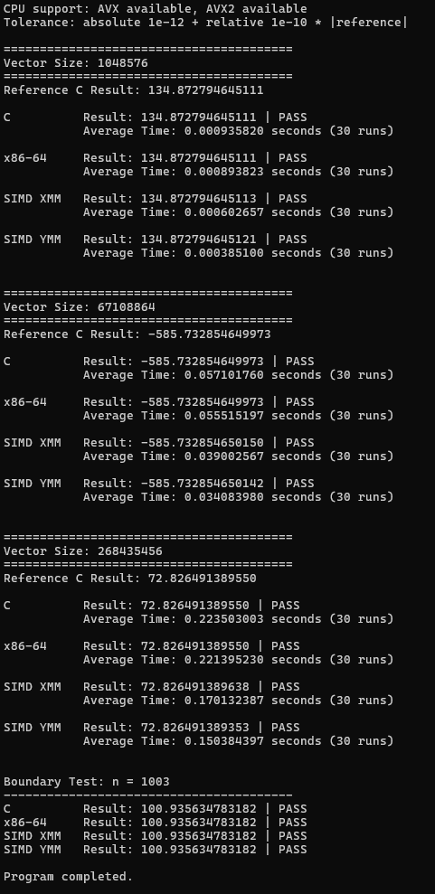
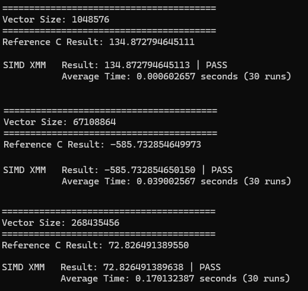
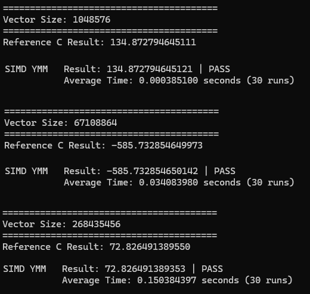
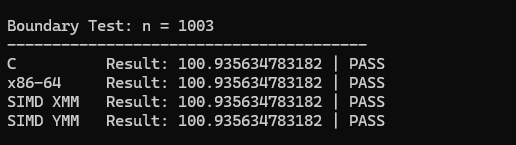

# CEPARCO-SIMD-Project

## 1. Project Overview

This project implements the **Vector Dot Product** using four different kernels:

1. C programming language
2. Non-SIMD x86-64 assembly language
3. SIMD AVX2 assembly using XMM registers (128-bit)
4. SIMD AVX2 assembly using YMM registers (256-bit)

The purpose is to compare the correctness and execution performance of the four implementations for different vector sizes.

### Mathematical Operation

The vector dot product is calculated as:

$Z = \sum_{i=0}^{n-1} A_i B_i$

where:

- `n` is the number of elements in the vectors.
- `A` and `B` are vectors containing double-precision floating-point values.
- `Z` is the resulting double-precision scalar.

All four kernels calculate the same mathematical operation. The C implementation serves as the reference for checking the correctness of the assembly implementations.

## 2. Experimental Setup

### Vector Sizes

The kernels were tested using three vector sizes:

| Test Case | Vector Size (`n`) |
|---|---:|
| Small | 1,048,576 |
| Medium | 67,108,864 |
| Large | 268,435,456 |
| Boundary Test | 1,003 |

The boundary test uses a vector size that is not evenly divisible by the number of elements processed per SIMD instruction.

### Data Initialization

The vectors were initialized with double-precision floating-point values. The exact initialization formula used in the program should be documented here.

Example initialization:

```c
for (int i = 0; i < n; i++) {
    A[i] = sin(i * 0.001);
    B[i] = cos(i * 0.002);
}
```

This produces different values for each vector element and provides a reproducible way to test the dot product, provided the same initialization is used for each kernel.

### Timing Methodology

- Each kernel was executed 30 times.
- The average execution time was recorded in seconds.
- Timing was intended to measure the kernel computation rather than vector initialization or memory allocation.
- Correctness was checked by comparing the result of each kernel against the reference C result.
- The reported benchmark results below should be associated with the Visual Studio build configuration used to obtain them. Separate Debug and Release measurements should be included when available.

## 3. Benchmark Results — Release Build

All measurements below were obtained using the **Visual Studio Release configuration**. Each kernel was executed 30 times, and the average execution time was recorded.

### Test Case 1: Vector Size = 1,048,576

Reference C result: `134.872794645111`

| Kernel | Result | Correctness | Average Time (s) |
|---|---:|---|---:|
| C | 134.872794645111 | PASS | 0.000845 |
| x86-64 Assembly | 134.872794645111 | PASS | 0.000836 |
| SIMD XMM | 134.872794645113 | PASS | 0.000511 |
| SIMD YMM | 134.872794645121 | PASS | 0.000368 |

### Test Case 2: Vector Size = 67,108,864

Reference C result: `-585.732854649973`

| Kernel | Result | Correctness | Average Time (s) |
|---|---:|---|---:|
| C | -585.732854649973 | PASS | 0.054842 |
| x86-64 Assembly | -585.732854649973 | PASS | 0.055070 |
| SIMD XMM | -585.732854650150 | PASS | 0.038542 |
| SIMD YMM | -585.732854650142 | PASS | 0.033942 |

### Test Case 3: Vector Size = 268,435,456

Reference C result: `72.826491389550`

| Kernel | Result | Correctness | Average Time (s) |
|---|---:|---|---:|
| C | 72.826491389550 | PASS | 0.224464 |
| x86-64 Assembly | 72.826491389550 | PASS | 0.221635 |
| SIMD XMM | 72.826491389638 | PASS | 0.156028 |
| SIMD YMM | 72.826491389353 | PASS | 0.136155 |

### Boundary Test: Vector Size = 1,003

| Kernel | Result | Correctness |
|---|---:|---|
| C | 100.935634783182 | PASS |
| x86-64 Assembly | 100.935634783182 | PASS |
| SIMD XMM | 100.935634783182 | PASS |
| SIMD YMM | 100.935634783182 | PASS |

All four kernels passed the reported correctness checks for the main vector sizes and the boundary test.

## 4. Comparative Performance Analysis

### 4.1 Speedup Relative to C

Speedup is calculated using:


$\text{Speedup}=\frac{T_C}{T_{\text{kernel}}}$


A value greater than 1 means the kernel is faster than C.

| Vector Size | x86-64 Assembly | SIMD XMM | SIMD YMM |
|---:|---:|---:|---:|
| 1,048,576 | 1.01× | 1.65× | 2.30× |
| 67,108,864 | 1.00×* | 1.42× | 1.62× |
| 268,435,456 | 1.01× | 1.44× | 1.65× |

*For the medium vector, the x86-64 assembly implementation was slightly slower than C, at approximately 0.996× the C performance.

### 4.2 Speedup Relative to Non-SIMD x86-64 Assembly

| Vector Size | SIMD XMM | SIMD YMM |
|---:|---:|---:|
| 1,048,576 | 1.64× | 2.27× |
| 67,108,864 | 1.43× | 1.62× |
| 268,435,456 | 1.42× | 1.63× |

### 4.3 Performance Observations

**C vs. non-SIMD x86-64 assembly**

In the Release build, C and non-SIMD assembly achieved nearly identical performance. The assembly implementation was marginally faster for the smallest and largest vector sizes, but slightly slower for the medium vector size.

This suggests that the compiler generated efficient machine code for the C implementation. Hand-written scalar assembly did not provide a consistent performance advantage over optimized C.

**SIMD XMM**

The XMM implementation was approximately 1.42–1.65 times faster than C. A 128-bit XMM register can process two double-precision values in parallel using packed floating-point instructions, reducing the number of scalar operations and loop iterations required.

**SIMD YMM**

The YMM implementation achieved the shortest execution time in every test. It was approximately 1.62–2.30 times faster than C and 1.62–2.27 times faster than non-SIMD assembly.

A 256-bit YMM register can hold four double-precision values, allowing more elements to be processed per packed operation. However, the actual speedup also depends on memory bandwidth, instruction scheduling, and reduction overhead.

## 5. Correctness Analysis

The C implementation was used as the reference answer. The results from the other three implementations were compared with the corresponding C result.

All kernels passed the reported correctness checks for the three main vector sizes and the 1,003-element boundary test.

Small differences in the final decimal places can occur because floating-point addition is not associative:


$(a+b)+c \ne a+(b+c)$

The SIMD implementations may accumulate partial sums in parallel and combine them in a different order from the scalar implementation. Consequently, their results can differ slightly due to floating-point rounding.

For example, for the vector size of 1,048,576, the C result was `134.872794645111`, while the YMM result was `134.872794645121`. This small difference is consistent with floating-point rounding, assuming the program's correctness check uses an appropriate tolerance.

## 6. Boundary Handling

The boundary test used `n = 1003`, which is not divisible by either SIMD vector width.

- **XMM:** Processes two double-precision elements per 128-bit vector operation.
- **YMM:** Processes four double-precision elements per 256-bit vector operation.

For XMM, the kernel can process the first 1,002 elements in groups of two, leaving one element.

For YMM, the kernel can process the first 1,000 elements in groups of four, leaving three elements.

The remaining elements must be processed using scalar instructions or another safe remainder-handling method.

The implementation must not load or access elements beyond the allocated vector boundaries. The reported boundary test passed for both SIMD implementations, indicating that the tested implementation handled the 1,003-element input correctly.

## 7. AHAness: Memory-Bound or Compute-Bound?

The vector dot product is generally considered a **memory-bound operation for sufficiently large vectors on modern processors**, because it performs relatively little arithmetic for every byte transferred from memory.

For each index, the kernel reads:

- One 8-byte double from vector A.
- One 8-byte double from vector B.
- One multiplication and one addition.

Ignoring cache effects, this corresponds to 16 bytes of input data for approximately two floating-point operations, or about 0.125 floating-point operations per byte.

This low arithmetic intensity means the processor may spend more time moving data than performing arithmetic, particularly when the vectors are too large to fit in cache.

For the largest test, each vector contains 268,435,456 double-precision elements. Each vector occupies approximately 2 GiB, so both vectors together occupy approximately 4 GiB of memory, excluding other program allocations.

Consequently, memory bandwidth is likely to be an important performance limitation for this test, although the actual bottleneck depends on the CPU, cache hierarchy, memory configuration, and compiler-generated instructions.

### Will SIMD YMM Be Faster Than Optimized C?

Not necessarily.

The YMM implementation was the fastest in the reported measurements, but an optimized C compiler may generate AVX2 instructions automatically. If the Release C build already vectorizes the dot product efficiently, hand-written YMM assembly may provide only a small improvement or no improvement at all.

SIMD improves the potential parallelism of the computation, but the realized speedup depends on whether the processor is limited by arithmetic throughput or memory bandwidth. When memory bandwidth becomes the limiting factor, wider SIMD instructions cannot guarantee a proportional speedup.

To make a fair comparison, all implementations should be tested under the same compiler optimization settings, with the same input data, equivalent timing methods, and appropriate correctness tolerances.

## 8. Why the Speedup Is Not Equal to Theoretical SIMD Speedup

Although YMM registers can process twice as many double-precision elements per instruction as XMM registers, the measured speedup is not necessarily 2×.

Possible reasons include:

1. **Memory bandwidth limitations:** The CPU may not be able to supply data fast enough to keep all SIMD execution units busy.
2. **Reduction overhead:** Multiple partial sums must eventually be combined into a single scalar result.
3. **Loop and instruction overhead:** Indexing, pointer updates, loop control, and other instructions still consume execution resources.
4. **Cache behavior:** Performance changes depending on whether the working set fits in cache or must be fetched from main memory.
5. **Compiler optimization:** The C compiler may already perform vectorization, loop unrolling, and other optimizations.
6. **Floating-point accumulation:** SIMD implementations may use different accumulation orders, producing small numerical differences.
7. **Processor characteristics:** SIMD throughput, memory channels, cache size, clock frequency, and thermal behavior affect the results.

The theoretical speedup represents an upper bound under particular assumptions, not a guarantee of actual application performance.

## 9. Visual Studio Debug vs. Release

Debug builds generally use fewer compiler optimizations, while Release builds enable optimizations to improve performance.

### 9.1 Execution Time Comparison

| Vector Size | Kernel | Debug (s) | Release (s) | Speedup |
|---:|---|---:|---:|---:|
| 1,048,576 | C | 0.002958 | 0.000845 | 3.50× |
| | x86-64 | 0.000882 | 0.000836 | 1.06× |
| | SIMD XMM | 0.000519 | 0.000511 | 1.02× |
| | SIMD YMM | 0.000397 | 0.000368 | 1.08× |
| 67,108,864 | C | 0.192386 | 0.054842 | 3.51× |
| | x86-64 | 0.058786 | 0.055070 | 1.07× |
| | SIMD XMM | 0.041537 | 0.038542 | 1.08× |
| | SIMD YMM | 0.035840 | 0.033942 | 1.06× |
| 268,435,456 | C | 0.765023 | 0.224464 | 3.41× |
| | x86-64 | 0.236492 | 0.221635 | 1.07× |
| | SIMD XMM | 0.168705 | 0.156028 | 1.08× |
| | SIMD YMM | 0.144646 | 0.136155 | 1.06× |

*Speedup = Debug time / Release time.*

### 9.2 Analysis

The C implementation improved by approximately 3.4–3.5× in Release mode, showing the significant impact of compiler optimizations. The assembly kernels improved by only about 1.02–1.08×.

SIMD YMM remained the fastest implementation in both configurations. For the largest vector size, it completed in 0.136155 seconds, approximately 1.65× faster than Release C.

Overall, Release optimization allowed C to approach scalar assembly performance, while SIMD provided additional speedup.

*Note: This comparison assumes the earlier measurements were collected in Debug mode and the latest measurements in Release mode. Verify the configurations before submission.*

## 10. Required Output Screenshots

### 10.1 Execution Times for All Vector Sizes



### 10.2 C Kernel Correctness


### 10.3 x86-64 Assembly Correctness


### 10.4 SIMD XMM Correctness



### 10.5 SIMD YMM Correctness



### 10.6 SIMD Boundary Test




## 11. Conclusion

Based on the supplied benchmark results, the SIMD YMM implementation achieved the shortest execution time for all three main vector sizes. SIMD XMM was the second-fastest, followed by non-SIMD x86-64 assembly and C.

For the largest vector size, YMM completed the kernel in 0.144646 seconds, compared with 0.168705 seconds for XMM, 0.236492 seconds for non-SIMD assembly, and 0.765023 seconds for C.

All four implementations passed the reported correctness checks, including the boundary test with 1,003 elements.
